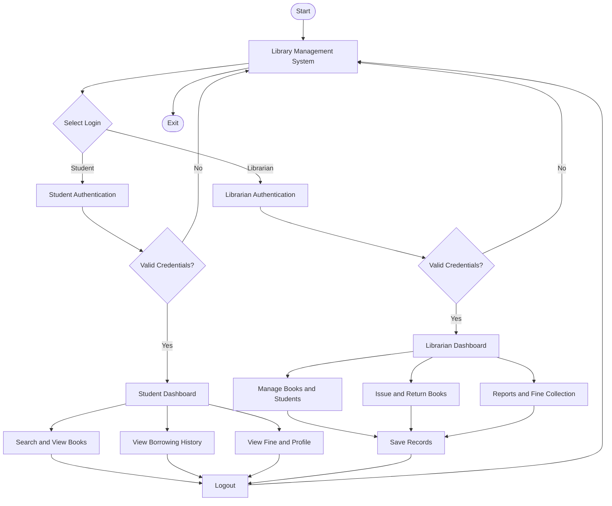

# 📚 Library Management System in C

A menu-driven **Library Management System** developed using the C programming language. This project is designed to simplify library operations by providing separate dashboards for librarians and students, with features for book management, student registration, book issuing, returning, and fine calculation.

The system uses structures, functions, arrays, and binary file handling to manage and persist library records.


---

## 📸 Project Preview

<!-- Add your project screenshots in the screenshots folder -->

<p align="center">
  
</p>

<p align="center">
  <em>Main Menu – Library Management System</em>
</p>

### Dashboard Previews

| Librarian Dashboard | Student Dashboard |
|---|---|
|  |  |


---

## ✨ Features

### 👨‍💼 Librarian Panel

The librarian has administrative access to manage the entire library.

- **Librarian Authentication:** Secure login using librarian ID and password.
- **Add Books:** Add new books with ISBN, title, author, publisher, category, edition, publication year, rack number, and number of copies.
- **Update Books:** Modify book details and inventory.
- **Delete Books:** Remove books from the library records when they are not currently issued.
- **Search Books:** Search books by title, author, category, or ISBN.
- **View All Books:** Display complete book information and availability.
- **Student Registration:** Register students and generate unique student IDs.
- **Student Management:** View registered student details.
- **Issue Books:** Assign books to registered students.
- **Return Books:** Process book returns and automatically update inventory.
- **Overdue Management:** Identify books that have crossed their return deadlines.
- **Fine Calculation:** Calculate late-return fines automatically.
- **Fine Collection:** Record fine payments.
- **Library Statistics:** View total books, available copies, issued books, registered students, and overdue records.

### 🎓 Student Panel

Students can log in and manage their personal library activities.

- **Student Login:** Authenticate using student ID and password.
- **My Profile:** View personal and academic information.
- **Search Books:** Find books using title, author, category, or ISBN.
- **Available Books:** View books currently available in the library.
- **My Borrowed Books:** View all borrowed and previously returned books.
- **Issue Details:** Check book issue dates and due dates.
- **Fine Details:** Check pending fines and current late-return fines.
- **Change Password:** Update the student login password.
- **Logout:** Securely exit the student dashboard.

---

## ⚙️ Library Rules

| Parameter | Value |
|---|---|
| Maximum books | 500 |
| Maximum registered students | 200 |
| Maximum issue records | 1000 |
| Maximum active books per student | 3 |
| Book borrowing period | 14 days |
| Late return fine | ₹5 per day |
| Book availability | Automatically updated |
| Data storage | Binary files |

---

## 🛠️ Technologies Used

| Technology | Purpose |
|---|---|
| C Programming | Core application development |
| Structures (`struct`) | Organizing book, student, and issue records |
| Functions | Modular programming |
| Arrays | Managing multiple records |
| Pointers | Accessing and modifying structures |
| String Handling | Processing names, titles, and passwords |
| File Handling | Permanent data storage |
| `time.h` | Date management and fine calculation |

---

## 📂 Project Structure

```text
Library-Management-System/
│
├── main.c                 # Main C source code
├── librarian.dat          # Librarian login credentials
│
├── books.dat              # Book records (auto-generated)
├── students.dat           # Student records (auto-generated)
├── issues.dat             # Book issue records (auto-generated)
│
├── screenshots/
│   ├── main-menu.png
│   ├── librarian-dashboard.png
│   └── student-dashboard.png
│
└── README.md
```

---

## 🚀 Getting Started

Follow these steps to run the project on your local machine.

### 1. Clone the Repository

```bash
git clone https://github.com/YOUR-USERNAME/Library-Management-System.git
```

### 2. Navigate to the Project Directory

```bash
cd Library-Management-System
```

### 3. Create Librarian Credentials

Create a file named `librarian.dat` in the project directory.

Add the following credentials:

```text
admin 12345
```

Default librarian login:

| Field | Credentials |
|---|---|
| Librarian ID | admin |
| Password | 12345 |

### 4. Compile the Program

Make sure GCC is installed on your system.

```bash
gcc main.c -o library
```

### 5. Run the Program

**Windows:**

```bash
library.exe
```

**Linux / macOS:**

```bash
./library
```

---

## 💻 Application Workflow



---

## 📊 Data Management

The application uses binary files to store records permanently.

| File | Description |
|---|---|
| `books.dat` | Stores book information and available copies |
| `students.dat` | Stores student profiles and login credentials |
| `issues.dat` | Stores issue dates, due dates, return dates, and fines |
| `librarian.dat` | Stores librarian login credentials |

The program uses:

- `fopen()` – Opens files.
- `fread()` – Reads binary records.
- `fwrite()` – Writes binary records.
- `fclose()` – Closes files.

Data is loaded when the program starts and saved whenever records are modified.

---

## 🔮 Future Enhancements

Some features that can be added in future versions:

- [ ] Graphical User Interface (GUI).
- [ ] Password encryption and stronger authentication.
- [ ] Book reservation system.
- [ ] Multiple librarian accounts.
- [ ] Fine payment history and receipts.
- [ ] Book issue and return reports.
- [ ] Export library records to CSV.
- [ ] Advanced search and sorting.
- [ ] Student account recovery.
- [ ] Database integration using MySQL or SQLite.

---

## ⚠️ Limitations

- The project uses fixed-size arrays to store records.
- Login credentials are stored in plain text.
- Binary data files are intended for use with this program's structure definitions.
- The project is designed for educational purposes and is not a production-ready library system.

---

## 🎯 Learning Outcomes

Through this project, I explored and implemented:

- Practical application of C programming concepts.
- Structure-based data management.
- File handling and permanent storage.
- Modular programming using functions.
- Authentication and role-based access.
- Searching and updating records.
- Date and time manipulation.
- Real-world problem-solving through programming.

---

## 👨‍💻 Author

**Aman Kumar**

MCA Student | C Programming | Software Development

- GitHub: [Your GitHub Profile](https://github.com/kumaramanofficial)
- Portfolio: [amankumarportfolio.in](https://www.amankumarportfolio.in/)

---

## 📄 License

This project is created for educational and academic purposes. You are welcome to explore, learn from, and modify the source code.

---

<p align="center">
  <b>Built with ❤️ using C Programming</b>
  <br>
  <i>Learning by building real-world projects.</i>
</p>
